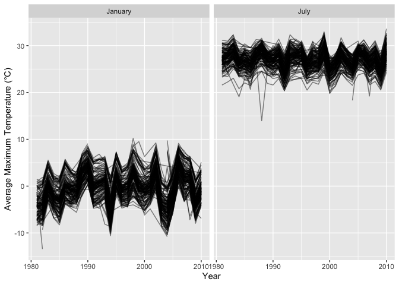
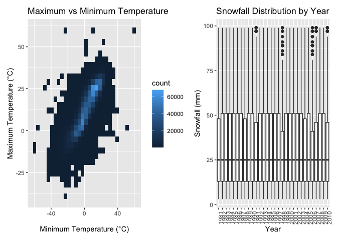

p8105_hw3_yj2931
================
Yuyao
2026-10-18

## Problem 1

### Section 1

``` r
library(p8105.datasets)
data("ny_noaa")
```

Do some data cleaning first. Give appropriate units for tmax (°C), tmin
(°C), precipitation (mm), and snowfall (mm).

``` r
ny_noaa_df =
  ny_noaa |>
  mutate(
    tmax = as.numeric(tmax) / 10,
    tmin = as.numeric(tmin) / 10,
    prcp = prcp / 10
  ) |> 
  drop_na(tmax, tmin)
```

Create separate variables for year, month, and day.

``` r
ny_noaa_df =
  ny_noaa_df |>
  separate(
    date,
    into = c("year", "month", "day"),
    sep = "-",
    remove = FALSE,
    convert = TRUE
  )
```

For snowfall, what are the most commonly observed values? Why?

``` r
snow_common =
  ny_noaa_df |>
  filter(!is.na(snow)) |>
  count(snow, sort = TRUE) |> 
  slice(1) |> 
  pull(snow)
```

The most commonly observed values for snowfall is 0 mm, because most
days have no snowfall, even during the winter months.

### Section 2

Calculate the average max temperature in January and in July in each
station across years.

``` r
jan_july_temp =
  ny_noaa_df |>
  filter(month %in% c(1, 7)) |>
  group_by(id, year, month) |>
  summarize(
    mean_tmax = mean(tmax, na.rm = TRUE),
    .groups = "drop"
  )
```

Make a two-panel plot showing the average max temperature in January and
in July in each station across years.

``` r
ggplot(
  jan_july_temp,
  aes(
    x = year,
    y = mean_tmax,
    group = id
  )
) +
  geom_line(alpha = 0.5) +
  facet_wrap(
    ~month,
    ncol = 2,
    labeller = as_labeller(c(
      `1` = "January",
      `7` = "July"
    ))
  ) +
  labs(
    x = "Year",
    y = "Average Maximum Temperature (°C)"
  )
```

<!-- -->

There is a clear seasonal pattern in average maximum temperature. The
average maximum temperature in July is around 26.9 °C, which is much
higher than the January average of around -0.3 °C. Temperatures vary
across stations and years, but there is no obvious overall temporal
trend. There are a few unusually low January station-year averages below
-10 °C, and one particularly low July observation around 14–15 °C, and
those unusually obervations can be considered as outliers.

Make a two-panel plot showing (i) tmax vs tmin for the full dataset

``` r
tmax_tmin_plot =
  ny_noaa_df |>
  drop_na(tmax, tmin) |>
  ggplot(
    aes(
      x = tmin,
      y = tmax
    )
  ) +
  geom_bin_2d() +
  labs(
    x = "Minimum Temperature (°C)",
    y = "Maximum Temperature (°C)",
    title = "Maximum vs Minimum Temperature"
  )
```

2)  make a plot showing the distribution of snowfall values greater than
    0 and less than 100 separately by year.

``` r
snow_plot =
  ny_noaa_df |>
  filter(
    snow > 0,
    snow < 100
  ) |>
  ggplot(
    aes(
      x = factor(year),
      y = snow
    )
  ) +
  geom_boxplot() +
  labs(
    x = "Year",
    y = "Snowfall (mm)",
    title = "Snowfall Distribution by Year"
  ) +
  theme(axis.text.x = element_text(angle = 90, hjust = 1))
```

Combine these two plots:

``` r
tmax_tmin_plot + snow_plot
```

    ## `stat_bin2d()` using `bins = 30`. Pick better value `binwidth`.

<!-- -->

Maximum and minimum temperatures show a clear positive association.
Snowfall distributions are relatively similar across years, with most
nonzero snowfall values below about 50 mm and a smaller number of higher
observations.
