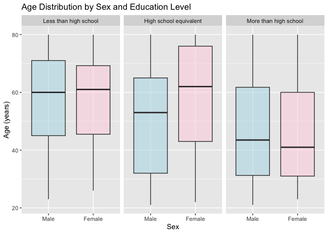
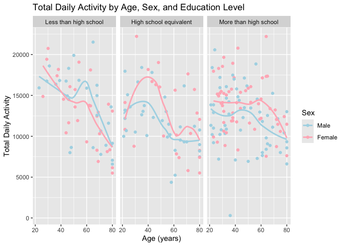
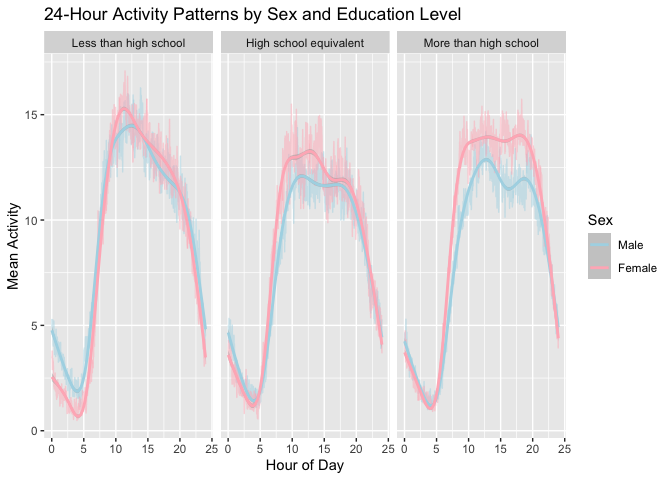
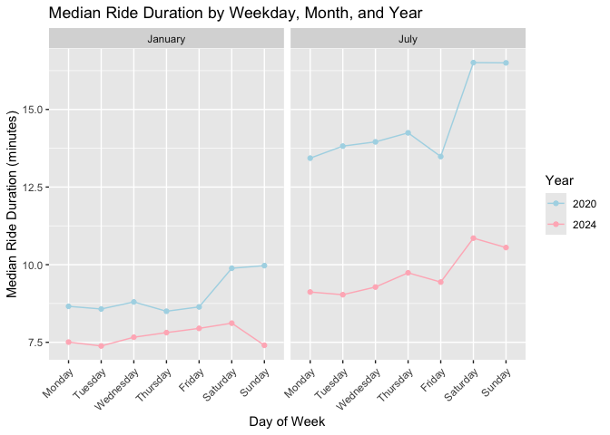
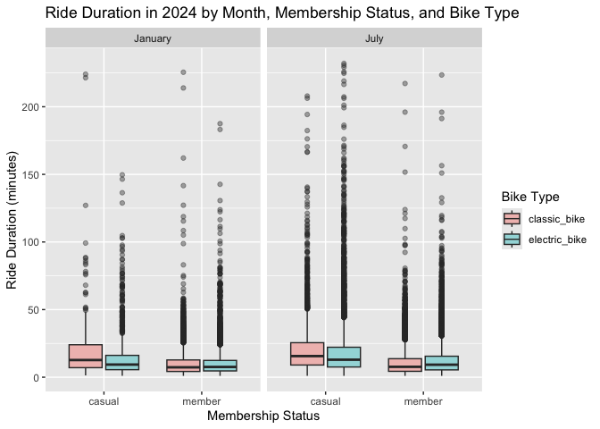

p8105_hw3_yj2931
================
Yuyao
2026-10-18

## Problem 1

### Section 1

``` r
library(p8105.datasets)
data("ny_noaa")
```

Do some data cleaning first. Give appropriate units for tmax (°C), tmin
(°C), precipitation (mm), and snowfall (mm).

``` r
ny_noaa_df =
  ny_noaa |>
  mutate(
    tmax = as.numeric(tmax) / 10,
    tmin = as.numeric(tmin) / 10,
    prcp = prcp / 10
  ) |> 
  drop_na(tmax, tmin)
```

Create separate variables for year, month, and day.

``` r
ny_noaa_df =
  ny_noaa_df |>
  separate(
    date,
    into = c("year", "month", "day"),
    sep = "-",
    remove = FALSE,
    convert = TRUE
  )
```

For snowfall, what are the most commonly observed values? Why?

``` r
snow_common =
  ny_noaa_df |>
  filter(!is.na(snow)) |>
  count(snow, sort = TRUE) |> 
  slice(1) |> 
  pull(snow)
```

The most commonly observed values for snowfall is 0 mm, because most
days have no snowfall, even during the winter months.

### Section 2

Calculate the average max temperature in January and in July in each
station across years.

``` r
jan_july_temp =
  ny_noaa_df |>
  filter(month %in% c(1, 7)) |>
  group_by(id, year, month) |>
  summarize(
    mean_tmax = mean(tmax, na.rm = TRUE),
    .groups = "drop"
  )
```

Make a two-panel plot showing the average max temperature in January and
in July in each station across years.

``` r
ggplot(
  jan_july_temp,
  aes(
    x = year,
    y = mean_tmax,
    group = id
  )
) +
  geom_line(alpha = 0.5) +
  facet_wrap(
    ~month,
    ncol = 2,
    labeller = as_labeller(c(
      `1` = "January",
      `7` = "July"
    ))
  ) +
  labs(
    x = "Year",
    y = "Average Maximum Temperature (°C)"
  )
```

<!-- -->

There is a clear seasonal pattern in average maximum temperature. The
average maximum temperature in July is around 26.9 °C, which is much
higher than the January average of around -0.3 °C. Temperatures vary
across stations and years, but there is no obvious overall temporal
trend. There are a few unusually low January station-year averages below
-10 °C, and one particularly low July observation around 14–15 °C, and
those unusually obervations can be considered as outliers.

Make a two-panel plot showing (i) tmax vs tmin for the full dataset

``` r
tmax_tmin_plot =
  ny_noaa_df |>
  drop_na(tmax, tmin) |>
  ggplot(
    aes(
      x = tmin,
      y = tmax
    )
  ) +
  geom_bin_2d() +
  labs(
    x = "Minimum Temperature (°C)",
    y = "Maximum Temperature (°C)",
    title = "Maximum vs Minimum Temperature"
  )
```

2)  make a plot showing the distribution of snowfall values greater than
    0 and less than 100 separately by year.

``` r
snow_plot =
  ny_noaa_df |>
  filter(
    snow > 0,
    snow < 100
  ) |>
  ggplot(
    aes(
      x = year,
      y = snow,
      group = year
    )
  ) +
  geom_boxplot() +
  labs(
    x = "Year",
    y = "Snowfall (mm)",
    title = "Snowfall Distribution by Year"
  ) 
```

Combine these two plots:

``` r
tmax_tmin_plot + snow_plot
```

    ## `stat_bin2d()` using `bins = 30`. Pick better value `binwidth`.

<!-- -->

Maximum and minimum temperatures show a clear positive association.
Snowfall distributions are relatively similar across years, with most
nonzero snowfall values below about 50 mm and a smaller number of higher
observations.

## Problem 2

### Section 1

Load, tidy, merge, and otherwise organize the data sets.

``` r
nhanes_covar_df =
  read_csv(
    "data/nhanes_covar.csv",
    skip = 4
  ) |>
  janitor::clean_names()
```

    ## Rows: 250 Columns: 5
    ## ── Column specification ────────────────────────────────────────────────────────
    ## Delimiter: ","
    ## dbl (5): SEQN, sex, age, BMI, education
    ## 
    ## ℹ Use `spec()` to retrieve the full column specification for this data.
    ## ℹ Specify the column types or set `show_col_types = FALSE` to quiet this message.

``` r
nhanes_accel_df =
  read_csv(
    "data/nhanes_accel.csv"
  ) |>
  janitor::clean_names() |>
  pivot_longer(
    cols = min1:min1440,
    names_to = "minute",
    values_to = "activity",
    names_prefix = "min"
  ) |>
  mutate(
    minute = as.integer(minute)
  )
```

    ## Rows: 250 Columns: 1441
    ## ── Column specification ────────────────────────────────────────────────────────
    ## Delimiter: ","
    ## dbl (1441): SEQN, min1, min2, min3, min4, min5, min6, min7, min8, min9, min1...
    ## 
    ## ℹ Use `spec()` to retrieve the full column specification for this data.
    ## ℹ Specify the column types or set `show_col_types = FALSE` to quiet this message.

Merge the two datasets together

``` r
nhanes_df =
  nhanes_accel_df |>
  inner_join(
    nhanes_covar_df,
    by = "seqn"
  )
```

Include: 1. all originally observed variables 2. exclude participants
less than 21 years of age, and those with missing demographic data 3.
encode data with reasonable variable classes

``` r
nhanes_df =
  nhanes_df |>
  filter(age >= 21) |>
  drop_na(sex, age, bmi, education) |>
  mutate(
    sex = factor(
      sex,
      levels = c(1, 2),
      labels = c("Male", "Female")
    ),
    education = factor(
      education,
      levels = c(1, 2, 3),
      labels = c(
        "Less than high school",
        "High school equivalent",
        "More than high school"
      ),
      ordered = TRUE
    )
  )
```

### Section 2

Produce a reader-friendly table for the number of men and women in each
education category

``` r
nhanes_df |>
  count(education, sex) |>
  pivot_wider(
    names_from = sex,
    values_from = n,
    values_fill = 0
  ) |>
  knitr::kable(
    col.names = c("Education Level", "Male", "Female"),
    caption = "Number of Participants by Sex and Education Level"
  )
```

| Education Level        |  Male | Female |
|:-----------------------|------:|-------:|
| Less than high school  | 38880 |  40320 |
| High school equivalent | 50400 |  33120 |
| More than high school  | 80640 |  84960 |

Number of Participants by Sex and Education Level

Create a visualization of the age distributions for men and women in
each education category.

``` r
nhanes_df |>
  ggplot(
    aes(
      x = sex,
      y = age,
      fill = sex
    )
  ) +
  geom_boxplot(alpha = 0.5) +
  facet_wrap(~education) +
  scale_fill_manual(
    values = c(
      "Male" = "lightblue",
      "Female" = "#FFD1DF"
    ) 
  ) +
  labs(
    x = "Sex",
    y = "Age (years)",
    title = "Age Distribution by Sex and Education Level"
  ) +
  theme(
    legend.position = "none"
  )
```

<!-- -->

Comment on these items: The age distributions for men and women are
fairly similar in the less-than-high-school and more-than-high-school
education groups. In the high-school-equivalent group, women tend to be
older than men, with a noticeably higher median age. Participants with
more than a high-school education also appear younger overall than those
in the other education categories.

### Section 3

Traditional analyses of accelerometer data focus on the total activity
over the day. Aggregate across minutes to create a total activity
variable for each participant.

``` r
nhanes_total_activity =
  nhanes_df |>
  group_by(seqn, sex, age, bmi, education) |>
  summarize(
    total_activity = sum(activity, na.rm = TRUE),
    .groups = "drop"
  )
```

Plot these total activities (y-axis) against age (x-axis); your plot
should compare men to women and have separate panels for each education
level. Include a trend line or a smooth to illustrate differences.

``` r
nhanes_total_activity |>
  ggplot(
    aes(
      x = age,
      y = total_activity,
      color = sex
    )
  ) +
  geom_point() +
  geom_smooth(se = FALSE) +
  facet_wrap(~education) +
  scale_color_manual(
    values = c(
      "Male" = "lightblue",
      "Female" = "lightpink"
    )
  ) +
  labs(
    x = "Age (years)",
    y = "Total Daily Activity",
    color = "Sex",
    title = "Total Daily Activity by Age, Sex, and Education Level"
  )
```

    ## `geom_smooth()` using method = 'loess' and formula = 'y ~ x'

<!-- -->

Comment on your plot: Total daily activity generally decreases with age
across all education groups. Women tend to have higher total activity
than men in the high-school-equivalent and more-than-high-school groups,
especially at younger and middle ages. In the less-than-high-school
group, the difference between men and women is smaller, and both show a
clear decline in activity at older ages.

### Section 3

Calculate the average activity at each minute for each sex and education
group

``` r
nhanes_activity_time =
  nhanes_df |>
  mutate(
    hour = minute / 60
  ) |>
  group_by(education, sex, hour) |>
  summarize(
    mean_activity = mean(activity)
  )
```

    ## `summarise()` has regrouped the output.
    ## ℹ Summaries were computed grouped by education, sex, and hour.
    ## ℹ Output is grouped by education and sex.
    ## ℹ Use `summarise(.groups = "drop_last")` to silence this message.
    ## ℹ Use `summarise(.by = c(education, sex, hour))` for per-operation grouping
    ##   (`?dplyr::dplyr_by`) instead.

Make a three-panel plot that shows the 24-hour activity time courses for
each education level and use color to indicate sex.

``` r
nhanes_activity_time |>
  ggplot(
    aes(
      x = hour,
      y = mean_activity,
      color = sex
    )
  ) +
  geom_line(alpha = 0.5) +
  geom_smooth() +
  facet_wrap(~education) +
  scale_color_manual(
    values = c(
      "Male" = "lightblue",
      "Female" = "lightpink"
    )
  ) +
  labs(
    x = "Hour of Day",
    y = "Mean Activity",
    color = "Sex",
    title = "24-Hour Activity Patterns by Sex and Education Level"
  )
```

    ## `geom_smooth()` using method = 'gam' and formula = 'y ~ s(x, bs = "cs")'

<!-- -->

Conclusion: Activity is lowest during the early morning hours, increases
rapidly after about 5–6 AM, peaks around late morning to early
afternoon, and then gradually declines through the evening. The overall
24-hour pattern is similar across all three education groups. Women
generally show higher daytime activity than men, especially in the
high-school-equivalent and more-than-high-school groups. In the
less-than-high-school group, the male and female activity patterns are
more similar, although women have a slightly higher peak around midday.

## Problem 3

### Section 1

Import, clean, and tidy these data, and describe the resulting dataset

``` r
jan_2020 =
  read_csv(
    "data/citibike/Jan 2020 Citi.csv",
  ) |>
  mutate(
    year = 2020,
    month = "January"
  )
```

    ## Rows: 12420 Columns: 7
    ## ── Column specification ────────────────────────────────────────────────────────
    ## Delimiter: ","
    ## chr (6): ride_id, rideable_type, weekdays, start_station_name, end_station_n...
    ## dbl (1): duration
    ## 
    ## ℹ Use `spec()` to retrieve the full column specification for this data.
    ## ℹ Specify the column types or set `show_col_types = FALSE` to quiet this message.

``` r
july_2020 =
  read_csv(
    "data/citibike/July 2020 Citi.csv",
  ) |>
  mutate(
    year = 2020,
    month = "July"
  )
```

    ## Rows: 21048 Columns: 7
    ## ── Column specification ────────────────────────────────────────────────────────
    ## Delimiter: ","
    ## chr (6): ride_id, rideable_type, weekdays, start_station_name, end_station_n...
    ## dbl (1): duration
    ## 
    ## ℹ Use `spec()` to retrieve the full column specification for this data.
    ## ℹ Specify the column types or set `show_col_types = FALSE` to quiet this message.

``` r
jan_2024 =
  read_csv(
    "data/citibike/Jan 2024 Citi.csv",
  ) |>
  mutate(
    year = 2024,
    month = "January"
  )
```

    ## Rows: 18861 Columns: 7
    ## ── Column specification ────────────────────────────────────────────────────────
    ## Delimiter: ","
    ## chr (6): ride_id, rideable_type, weekdays, start_station_name, end_station_n...
    ## dbl (1): duration
    ## 
    ## ℹ Use `spec()` to retrieve the full column specification for this data.
    ## ℹ Specify the column types or set `show_col_types = FALSE` to quiet this message.

``` r
july_2024 =
  read_csv(
    "data/citibike/July 2024 Citi.csv",
  ) |>
  mutate(
    year = 2024,
    month = "July"
  )
```

    ## Rows: 47156 Columns: 7
    ## ── Column specification ────────────────────────────────────────────────────────
    ## Delimiter: ","
    ## chr (6): ride_id, rideable_type, weekdays, start_station_name, end_station_n...
    ## dbl (1): duration
    ## 
    ## ℹ Use `spec()` to retrieve the full column specification for this data.
    ## ℹ Specify the column types or set `show_col_types = FALSE` to quiet this message.

``` r
citi_df =
  bind_rows(
    jan_2020,
    july_2020,
    jan_2024,
    july_2024
  )
```

The combined Citi Bike dataset contains 99485 rides and 9 variables from
January and July of 2020 and 2024. Each observation represents one Citi
Bike ride. Key variables include ride ID, bike type, day of the week,
ride duration, starting and ending station, rider membership status,
year, and month. The four datasets were imported separately, variables
for year and month were added based on the source file, and the datasets
were combined into a single tidy dataset.

### Section 2

Produce a reader-friendly table showing the total number of rides in
each combination of year and month separating casual riders and Citi
Bike members.

``` r
ride_table =
  citi_df |>
  count(year, month, member_casual) |>
  pivot_wider(
    names_from = member_casual,
    values_from = n,
    values_fill = 0
  ) |> 
  knitr::kable(
    col.names = c("Year", "Month", "Casual", "Member"),
    caption = "Number of Citi Bike Rides by Year, Month, and Membership Status"
  )
```

The number of rides increased from 2020 to 2024 for both members and
casual riders. In both years, ridership was higher in July than in
January. Citi Bike members consistently had more rides than casual
riders, with the highest number of rides occurring among members in July
2024.

### Section 3

Make a table showing the 5 most popular starting stations for July 2024;
include the number of rides originating from these stations.

``` r
top5_stations =
  citi_df |>
  filter(
    year == 2024,
    month == "July",
    !is.na(start_station_name)
  ) |>
  count(
    start_station_name,
    sort = TRUE
  ) |>
  head(5) |> 
  knitr::kable(
    col.names = c("Starting Station", "Number of Rides"),
    caption = "Five Most Popular Starting Stations in July 2024"
  )
```

### Section 4

Fix the order of plot first

``` r
citi_df =
  citi_df |>
  mutate(
    weekdays = factor(
      weekdays,
      levels = c(
        "Monday", "Tuesday", "Wednesday",
        "Thursday", "Friday", "Saturday", "Sunday"
      )
    )
  )
```

Calculate the median ride duration

``` r
median_ride_df =
  citi_df |>
  group_by(year, month, weekdays) |>
  summarize(
    median_duration = median(duration, na.rm = TRUE),
    .groups = "drop"
  )
```

Make a plot to investigate the effects of day of the week, month, and
year on median ride duration.

``` r
median_ride_df |>
  ggplot(
    aes(
      x = weekdays,
      y = median_duration,
      color = factor(year),
      group = year
    )
  ) +
  geom_point() +
  geom_line() +
  facet_wrap(~month) +
  labs(
    x = "Day of Week",
    y = "Median Ride Duration (minutes)",
    color = "Year",
    title = "Median Ride Duration by Weekday, Month, and Year"
  ) +
   scale_color_manual(
    values = c(
      "2020" = "lightblue",
      "2024" = "lightpink"
    )
  ) +
  theme(axis.text.x = element_text(angle = 45, hjust = 1))
```

<!-- -->

Median ride duration was consistently longer in July than in January and
was higher in 2020 than in 2024. Weekend rides, especially on Saturday
and Sunday, tended to have longer median durations than weekday rides,
with the largest difference observed in July 2020. Overall, ride
durations appear to vary by season, year, and day of the week.

### Section 5

For data in 2024, make a figure that shows the impact of month,
membership status, and bike type on the distribution of ride duration.

``` r
citi_df |>
  filter(year == 2024) |>
  ggplot(
    aes(
      x = member_casual,
      y = duration,
      fill = rideable_type
    )
  ) +
  geom_boxplot(alpha = 0.4) +
  facet_wrap(~month) +
  labs(
    x = "Membership Status",
    y = "Ride Duration (minutes)",
    fill = "Bike Type",
    title = "Ride Duration in 2024 by Month, Membership Status, and Bike Type"
  )
```

<!-- -->
Ride durations were generally longer for casual riders than for members,
and rides tended to be longer in July than in January. Among casual
riders, classic-bike rides were typically longer than electric-bike
rides. For members, the difference between bike types was smaller,
although electric-bike rides tended to be slightly longer, especially in
July. All groups show right-skewed ride-duration distributions with a
number of unusually long rides.
